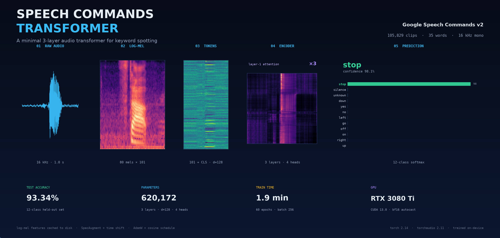
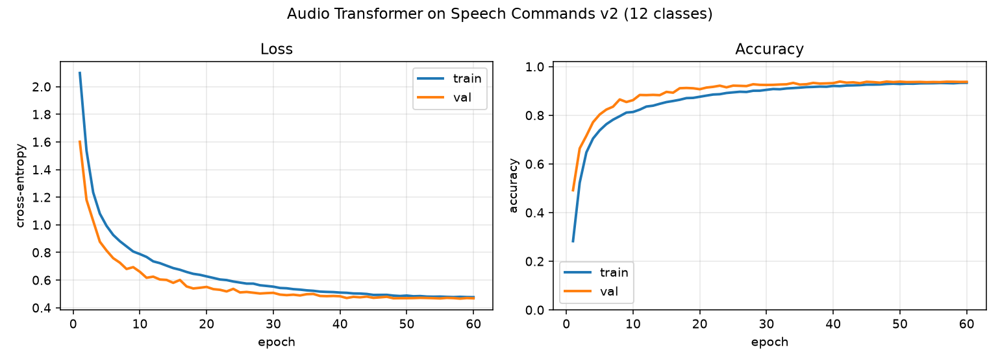
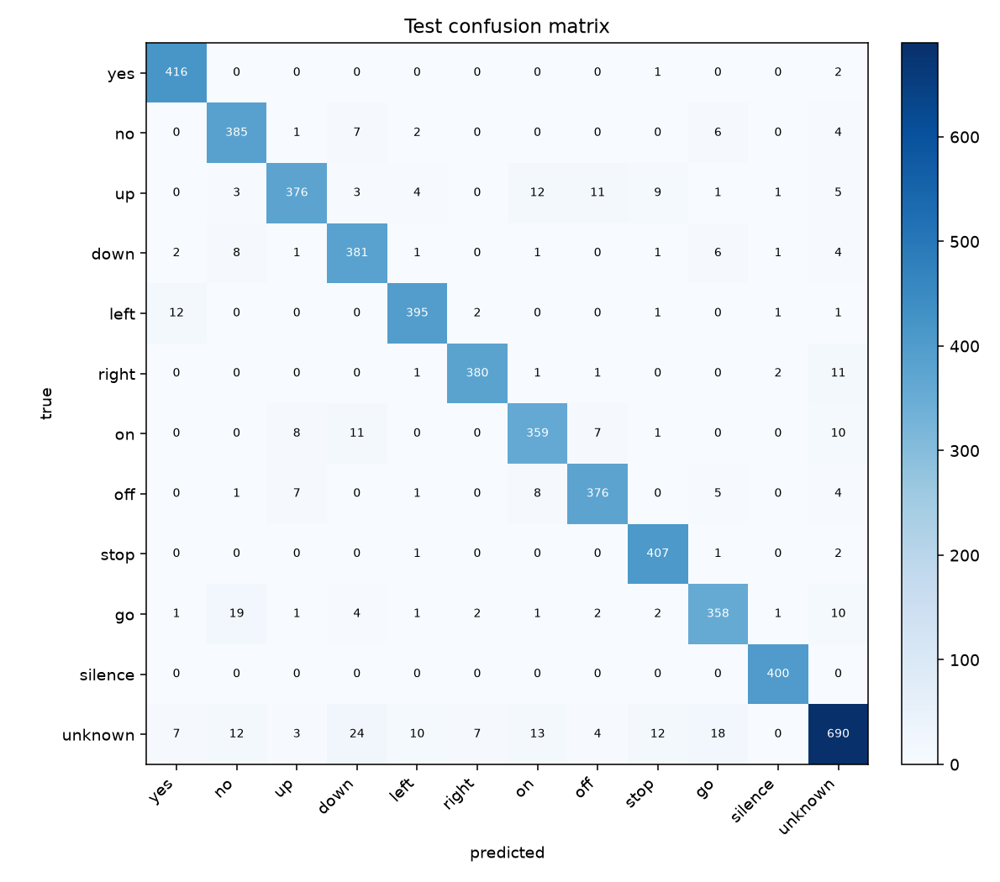
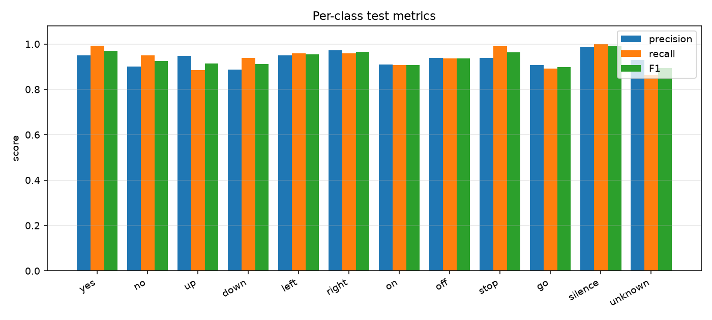
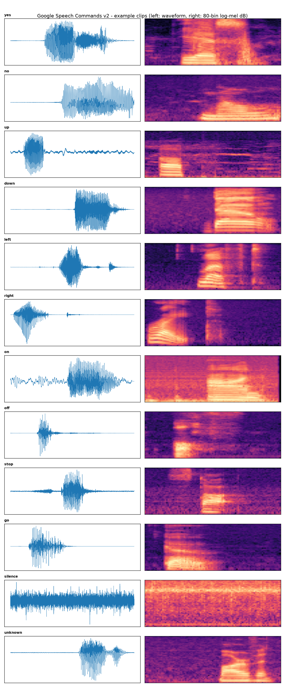
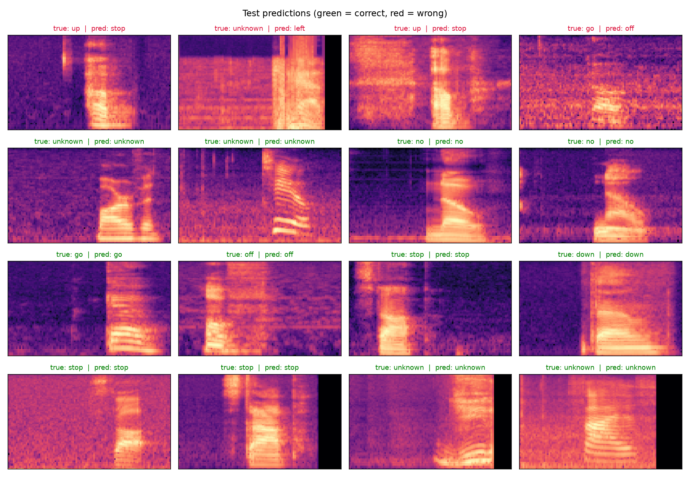

<p align="center">
  
</p>

<p align="center">
  
  
  
  
  
</p>

A deliberately minimal transformer for keyword spotting on [Google Speech Commands v2](https://arxiv.org/abs/1804.03209). No CNN front-end, no pretraining, no tricks in the model — just log-mel frames as tokens, three pre-norm encoder layers, and a CLS readout. It reaches **93.34% test accuracy** on the 12-class task and trains in **under 2 minutes** on a single RTX 3080 Ti.

```
raw audio (1 s, 16 kHz)
  → log-mel spectrogram (80 × 101)
  → Linear(80 → 128) + [CLS] + learned positional embeddings
  → 3 × TransformerEncoderLayer (d=128, 4 heads, FFN=512, GELU, pre-norm)
  → CLS pooling → LayerNorm → Linear(128 → 12)
```

## Highlights

- **620,172 parameters** — small enough to train from scratch in ~2 minutes.
- **93.34% test accuracy** with the official speaker-disjoint splits.
- **No convolutional stem**: each 10 ms frame is a token; the encoder sees 101 tokens plus CLS.
- **Cached features**: log-mels are computed once and saved to disk, so epochs are fast.
- **bf16 autocast** on GPU, SpecAugment + random time shift for regularization.

## Results

| Metric | Value |
|---|---|
| Test accuracy | **93.34%** |
| Best validation accuracy | 93.84% (epoch 41 / 60) |
| Test cross-entropy | 0.473 |
| Parameters | 620,172 |
| Training time | 1.9 min on NVIDIA RTX 3080 Ti |
| Input / features | 16 kHz mono, 80-bin log-mel, 101 frames |

| Training curves | Confusion matrix |
|:---:|:---:|
|  |  |

<p align="center">
  
</p>

<details>
<summary><b>Per-class test metrics</b></summary>

| Class | Precision | Recall | F1 |
|---|---:|---:|---:|
| `yes` | 95.0 | 99.3 | 97.1 |
| `no` | 90.0 | 95.1 | 92.4 |
| `up` | 94.7 | 88.5 | 91.5 |
| `down` | 88.6 | 93.8 | 91.1 |
| `left` | 95.0 | 95.9 | 95.4 |
| `right` | 97.2 | 96.0 | 96.6 |
| `on` | 90.9 | 90.7 | 90.8 |
| `off` | 93.8 | 93.5 | 93.6 |
| `stop` | 93.8 | 99.0 | 96.3 |
| `go` | 90.6 | 89.1 | 89.8 |
| `silence` | 98.5 | 100.0 | 99.3 |
| `unknown` | 92.9 | 86.2 | 89.4 |

</details>

## Dataset

Speech Commands v2 contains 105,829 one-second utterances from 2,618 speakers across 35 words. This project solves the standard 12-class variant: ten keywords plus `silence` and `unknown`.

- **Splits** come from the dataset's official `validation_list.txt` and `testing_list.txt`, which are speaker-disjoint — no speaker appears in more than one split.
- **`silence`** is generated from random 1-second crops of the `_background_noise_` recordings.
- **`unknown`** is sampled from the 25 non-target words, capped to keep the classes reasonable: 3,000 train / 800 val / 800 test.

| Split | Target words | Unknown | Silence | Total |
|---|---:|---:|---:|---:|
| train | 30,769 | 3,000 | 1,500 | **35,269** |
| validation | 3,703 | 800 | 400 | **4,903** |
| test | 4,074 | 800 | 400 | **5,274** |

Features: 25 ms window, 10 ms hop, 80 mel bins, 20–7600 Hz, converted to dB and normalized with train-set mean/std (`-33.51 / 23.80`).

<details>
<summary><b>Example clips from every class</b></summary>
<p align="center">
  
</p>
</details>

<details>
<summary><b>Sample test predictions</b></summary>
<p align="center">
  
</p>
</details>

## Training recipe

| Setting | Value |
|---|---|
| Optimizer | AdamW, weight decay 0.01 |
| Learning rate | 3e-4, 1-epoch warmup, cosine decay to 5% |
| Batch size | 256 |
| Epochs | 60 |
| Precision | bf16 autocast |
| Loss | cross-entropy, label smoothing 0.05 |
| Augmentation | ±80 ms time shift, 2 SpecAugment masks |
| Gradient clipping | 1.0 |
| Seed | 1337 |

## Quickstart

Requires Python 3.14, a CUDA GPU, and ~3 GB of disk for the dataset plus ~700 MB for cached features.

```bash
# 1. environment
python3 -m venv .venv
.venv/bin/pip install torch torchaudio numpy soundfile matplotlib tqdm

# 2. dataset (speech_commands_v0.02, ~2.3 GB)
mkdir -p data
curl -L -o data/speech_commands_v0.02.tar.gz \
  http://download.tensorflow.org/data/speech_commands_v0.02.tar.gz
mkdir -p data/speech_commands
tar -xzf data/speech_commands_v0.02.tar.gz -C data/speech_commands

# 3. cache log-mel features
.venv/bin/python prepare_data.py

# 4. train + evaluate (writes checkpoints/ and plots/)
.venv/bin/python train.py
```

`train.py` refuses to run on CPU. The hero figure can be regenerated with:

```bash
.venv/bin/python assets/make_hero.py
```

## Project layout

```
.
├── assets/
│   ├── hero.png              # README banner (real model outputs)
│   └── make_hero.py          # regenerates the banner
├── checkpoints/
│   └── best_model.pt         # best validation checkpoint
├── data/                     # Speech Commands v2 (not committed)
├── prepared/                 # cached log-mels + stats (not committed)
├── plots/                    # figures and metrics.json
├── prepare_data.py           # download-agnostic manifest + feature cache
├── train.py                  # model, training loop, evaluation, plots
├── final_model.pt            # final-epoch weights
└── README.md
```

## Notes and next steps

- Only 10 of the 35 words are used. Add more entries to `TARGET_WORDS` in `prepare_data.py` to train the full 35-class task.
- Raising the `unknown` cap (or matching it to the full unknown pool) should improve unknown recall, which is the weakest class at 86.2%.
- The model is intentionally small. Bigger `d_model`, more layers, background-noise mixing, and longer schedules should close the gap to the ~97–98% typical for this dataset.
- `plots/metrics.json` contains the full training history and confusion matrix if you want to build your own charts.

## Acknowledgements

- Warden, P. (2018). *Speech Commands: A Dataset for Limited-Vocabulary Speech Recognition*. [arXiv:1804.03209](https://arxiv.org/abs/1804.03209)
- Built with [PyTorch](https://pytorch.org/) and [torchaudio](https://pytorch.org/audio/).
